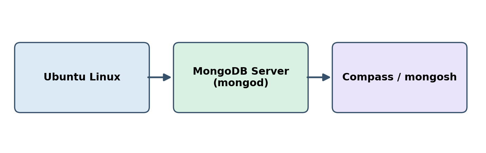
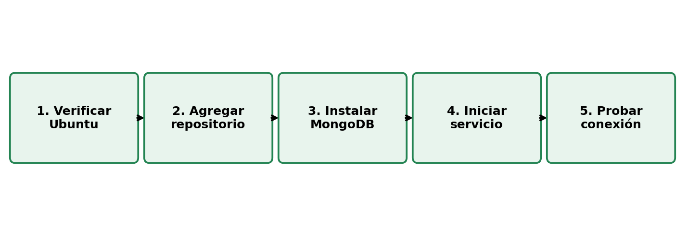
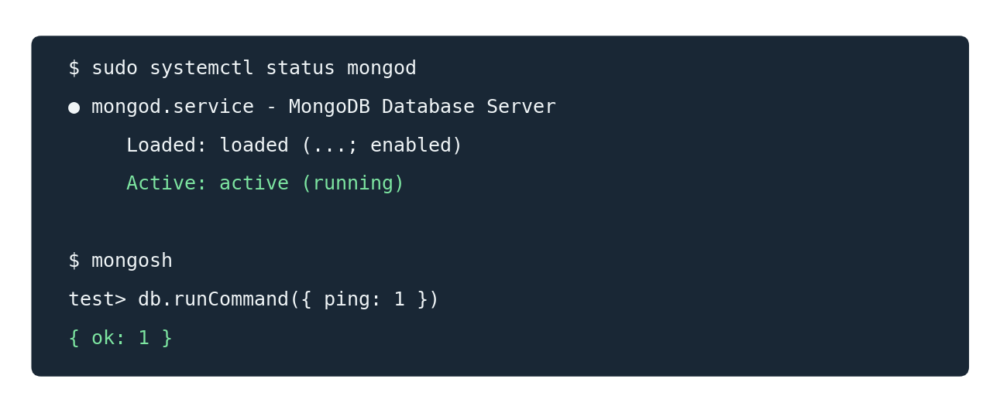

> **Nota:** Las salidas de terminal son ejemplos didácticos, no capturas de una ejecución real. Los identificadores, versiones y tiempos pueden variar.

# MongoDB en Ubuntu

> Guía académica para estudiantes principiantes.


MANUAL DE INSTALACIÓN Y CONFIGURACIÓN
DE MONGODB EN UBUNTU


Base de datos NoSQL · Guía para estudiantes principiantes





Figura 1. Componentes básicos del entorno MongoDB.


Modalidad: práctica guiada en Linux Ubuntu


Versiones de referencia: Ubuntu 22.04 / 24.04 LTS y MongoDB 8.0


Fecha de elaboración: noviembre de 2026


Autor: material de apoyo académico


1. Introducción


2. Objetivo, propósito y alcance


3. Requisitos previos


4. Conceptos esenciales


5. Método A: instalación mediante comandos APT


6. Método B: interfaz gráfica MongoDB Compass


7. Método C: ejecución alternativa con Docker


8. Práctica: crear y consultar una base de datos


9. Errores frecuentes y soluciones


10. Seguridad y buenas prácticas


11. Lista de verificación


12. Conclusión y referencias


Nota: los títulos están configurados como encabezados de Word para facilitar la navegación y la creación de una tabla de contenido automática.


## Introducción


Una base de datos NoSQL permite guardar información sin exigir que todos los registros tengan las mismas columnas. MongoDB es una base de datos documental: almacena documentos similares a JSON en colecciones. Este manual enseña a instalar un servidor local en Ubuntu, conectarse y realizar operaciones básicas.


## Objetivo, propósito y alcance


Objetivo: instalar y verificar MongoDB Community Edition en un equipo Ubuntu y ejecutar una práctica inicial de inserción y consulta.


Propósito: ofrecer instrucciones reproducibles, explicadas paso a paso, para estudiantes con conocimientos básicos de bases de datos.


Alcance: equipos de laboratorio o aprendizaje con Ubuntu 22.04/24.04 LTS de 64 bits, conexión a Internet y permisos sudo. No cubre despliegues de producción, clústeres ni acceso público desde Internet.


## Requisitos previos

- Ubuntu 22.04 LTS (jammy) o 24.04 LTS (noble), 64 bits; arquitectura compatible con la versión elegida.
- Usuario con permisos sudo, acceso a terminal y conexión estable a Internet.
- Recomendación para laboratorio: al menos 4 GB de RAM, 2 GB de espacio libre y capacidad adicional para datos (no son mínimos oficiales).
- Para Compass: entorno de escritorio gráfico y navegador web. Para Docker: Docker Engine instalado y funcionando.
- Guardar copia de seguridad si ya existe una instalación o datos de MongoDB.

### Comprobar versión y arquitectura


La distribución debe indicar 22.04 o 24.04; la arquitectura habitual es x86_64 (amd64).


```bash
lsb_release -a; uname -m
```

**Resultado esperado (ejemplo ilustrativo):**

```text
Ubuntu 24.04 LTS / x86_64 (ejemplo; puede mostrar 22.04).
```

**Cómo interpretarlo:** Confirma la versión y arquitectura antes de elegir el repositorio.

**Si no coincide:** revisa el mensaje de error, la conexión y la sección de solución de problemas.


## Conceptos esenciales


mongod: proceso servidor que almacena datos. mongosh: consola interactiva para consultar y modificar datos. MongoDB Compass: aplicación gráfica para explorar bases y colecciones. APT: gestor de paquetes de Ubuntu. Docker: sistema para ejecutar MongoDB dentro de un contenedor.





Figura 2. Secuencia lógica de instalación y comprobación.


## Método A: instalación mediante comandos APT


Método recomendado para aprender la instalación local. Los comandos siguientes utilizan el repositorio oficial de MongoDB 8.0. Ejecútalos en la terminal de Ubuntu, no dentro de mongosh.


### Paso 1. Actualizar el índice de paquetes


Introduce la contraseña del usuario cuando Ubuntu la solicite; al escribirla no se muestran caracteres.


```bash
sudo apt-get update
```

**Resultado esperado (ejemplo ilustrativo):**

```text
Reading package lists... Done
```

**Cómo interpretarlo:** Se actualizó el índice de paquetes sin errores.

**Si no coincide:** revisa el mensaje de error, la conexión y la sección de solución de problemas.


### Paso 2. Instalar herramientas necesarias


```bash
sudo apt-get install -y gnupg curl
```

**Resultado esperado (ejemplo ilustrativo):**

```text
Setting up gnupg ...
Setting up curl ...
```

**Cómo interpretarlo:** Las herramientas quedaron instaladas; si ya existían, APT puede indicar que están actualizadas.

**Si no coincide:** revisa el mensaje de error, la conexión y la sección de solución de problemas.


### Paso 3. Importar la clave de firma del repositorio


La clave permite verificar los paquetes descargados. No ignores errores de firma.


```bash
curl -fsSL https://pgp.mongodb.com/server-8.0.asc | \
  sudo gpg --dearmor -o /usr/share/keyrings/mongodb-server-8.0.gpg
```

**Resultado esperado (ejemplo ilustrativo):**

```text
(Normalmente no muestra texto cuando termina correctamente.)
```

**Cómo interpretarlo:** Verifica la clave con: ls -l /usr/share/keyrings/mongodb-server-8.0.gpg

**Si no coincide:** revisa el mensaje de error, la conexión y la sección de solución de problemas.


### Paso 4. Registrar el repositorio oficial para Ubuntu 24.04


Si utilizas Ubuntu 22.04, usa el comando alternativo que aparece debajo; NO ejecutes ambos.


```bash
echo "deb [ arch=amd64,arm64 signed-by=/usr/share/keyrings/mongodb-server-8.0.gpg ] https://repo.mongodb.org/apt/ubuntu noble/mongodb-org/8.0 multiverse" | sudo tee /etc/apt/sources.list.d/mongodb-org-8.0.list
```

**Resultado esperado (ejemplo ilustrativo):**

```text
deb [ arch=amd64,arm64 signed-by=... ] https://repo.mongodb.org/apt/ubuntu noble/mongodb-org/8.0 multiverse
```

**Cómo interpretarlo:** Se registró el repositorio. En Ubuntu 22.04 debe aparecer jammy, no noble.

**Si no coincide:** revisa el mensaje de error, la conexión y la sección de solución de problemas.


```bash
echo "deb [ arch=amd64,arm64 signed-by=/usr/share/keyrings/mongodb-server-8.0.gpg ] https://repo.mongodb.org/apt/ubuntu jammy/mongodb-org/8.0 multiverse" | sudo tee /etc/apt/sources.list.d/mongodb-org-8.0.list
```

**Resultado esperado (ejemplo ilustrativo):**

```text
deb [ arch=amd64,arm64 signed-by=... ] https://repo.mongodb.org/apt/ubuntu noble/mongodb-org/8.0 multiverse
```

**Cómo interpretarlo:** Se registró el repositorio. En Ubuntu 22.04 debe aparecer jammy, no noble.

**Si no coincide:** revisa el mensaje de error, la conexión y la sección de solución de problemas.


### Paso 5. Actualizar repositorios e instalar MongoDB


El paquete mongodb-org instala el servidor y los componentes oficiales, incluido mongosh según el empaquetado de MongoDB.


```bash
sudo apt-get update
sudo apt-get install -y mongodb-org
```

**Resultado esperado (ejemplo ilustrativo):**

```text
Reading package lists... Done
```

**Cómo interpretarlo:** Se actualizó el índice de paquetes sin errores.

**Si no coincide:** revisa el mensaje de error, la conexión y la sección de solución de problemas.


### Paso 6. Iniciar el servicio y habilitar el arranque automático


```bash
sudo systemctl start mongod
sudo systemctl enable mongod
```

**Resultado esperado (ejemplo ilustrativo):**

```text
Created symlink ... (puede aparecer solo al habilitar el servicio)
```

**Cómo interpretarlo:** El inicio puede no mostrar texto; verifica el estado en el paso siguiente.

**Si no coincide:** revisa el mensaje de error, la conexión y la sección de solución de problemas.


### Paso 7. Comprobar que el servicio esté activo


Debe aparecer “active (running)”. Pulsa la tecla q para salir de la vista de estado.


```bash
sudo systemctl status mongod
```

**Resultado esperado (ejemplo ilustrativo):**

```text
Active: active (running)
```

**Cómo interpretarlo:** El servidor MongoDB está ejecutándose.

**Si no coincide:** revisa el mensaje de error, la conexión y la sección de solución de problemas.


### Paso 8. Abrir la consola y comprobar conexión


La segunda línea se ejecuta dentro de mongosh. Debe responder con ok: 1. Para salir escribe exit.


```bash
mongosh
# Dentro de mongosh:
db.runCommand({ ping: 1 })
```





Figura 3. Ejemplo ilustrativo de resultados correctos; no es una captura real.


## Método B: interfaz gráfica MongoDB Compass


Compass no sustituye al servidor MongoDB: es una aplicación gráfica para conectarse a un servidor ya instalado (Método A) o remoto. Es la opción más sencilla para visualizar colecciones.


### Paso 1. Descargar Compass


Desde Ubuntu abre la página oficial y selecciona la descarga .deb apropiada para tu sistema. Evita sitios de terceros.


| https://www.mongodb.com/try/download/compass |
| --- |


### Paso 2. Instalar el archivo .deb descargado


Abre la carpeta Descargas, haz doble clic sobre el paquete .deb y elige “Instalar” en el instalador de aplicaciones de Ubuntu. La interfaz puede cambiar según la versión.


### Paso 3. Abrir Compass y establecer conexión


Busca “MongoDB Compass” en Aplicaciones. En el campo URI escribe mongodb://localhost:27017 y pulsa Connect. El servidor mongod debe estar iniciado.


### Paso 4. Crear una base desde Compass


Selecciona Create Database. Nombre de base: instituto. Nombre de colección: estudiantes. Confirma y abre la colección para explorar sus documentos.


Alternativa gráfica: en algunos sistemas el archivo .deb se puede instalar desde el centro de software; si no se abre, usa el comando sudo apt install ./nombre-del-archivo.deb desde la carpeta donde está el archivo, sustituyendo el nombre real.


## Método C: ejecución alternativa con Docker


Este método crea un servidor MongoDB aislado en un contenedor. Requiere Docker Engine previamente instalado; no es una instalación nativa de MongoDB en Ubuntu.


### Paso 1. Confirmar Docker


Si Docker no está instalado, sigue la guía oficial de Docker Engine para Ubuntu: https://docs.docker.com/engine/install/ubuntu/


```bash
docker --version; sudo docker info
```

**Resultado esperado (ejemplo ilustrativo):**

```text
Docker version XX.X.X
```

**Cómo interpretarlo:** Docker está instalado; el número depende del equipo.

**Si no coincide:** revisa el mensaje de error, la conexión y la sección de solución de problemas.


### Paso 2. Descargar y ejecutar MongoDB 8.0


El volumen conserva los datos al eliminar el contenedor. La publicación 127.0.0.1 limita la conexión al equipo local.


```bash
sudo docker volume create mongo_datos; sudo docker run -d --name mongo-aula -p 127.0.0.1:27017:27017 -v mongo_datos:/data/db mongo:8.0
```

**Resultado esperado (ejemplo ilustrativo):**

```text
mongo_datos
<identificador del contenedor>
```

**Cómo interpretarlo:** Se creó un volumen persistente y el contenedor arrancó.

**Si no coincide:** revisa el mensaje de error, la conexión y la sección de solución de problemas.


### Paso 3. Comprobar y acceder a mongosh


Para detener: sudo docker stop mongo-aula. Para volver a iniciar: sudo docker start mongo-aula. No ejecutes el contenedor a la vez que el servidor nativo en el mismo puerto 27017.


```bash
sudo docker ps; sudo docker exec -it mongo-aula mongosh
```

**Resultado esperado (ejemplo ilustrativo):**

```text
CONTAINER ID   IMAGE       STATUS       PORTS
...            mongo:8.0   Up ...       127.0.0.1:27017->27017/tcp
```

**Cómo interpretarlo:** MongoDB está activo dentro de Docker.

**Si no coincide:** revisa el mensaje de error, la conexión y la sección de solución de problemas.


## Práctica: crear y consultar una base de datos


Ejecuta estas instrucciones dentro de mongosh, ya sea con el Método A o el Método C.


### Paso 1. Seleccionar la base de datos


La base se materializa cuando se guardan datos por primera vez.


```bash
use instituto
```

**Resultado esperado (ejemplo ilustrativo):**

```text
switched to db instituto
```

**Cómo interpretarlo:** La base se seleccionó; se guardará cuando se inserten documentos.

**Si no coincide:** revisa el mensaje de error, la conexión y la sección de solución de problemas.


### Paso 2. Insertar dos documentos


```bash
db.estudiantes.insertMany([;   { nombre: "Ana", programa: "Sistemas", semestre: 1 },;   { nombre: "Luis", programa: "Sistemas", semestre: 2 }; ])
```

**Resultado esperado (ejemplo ilustrativo):**

```text
{ acknowledged: true, insertedIds: { ... } }
```

**Cómo interpretarlo:** Se insertaron dos documentos.

**Si no coincide:** revisa el mensaje de error, la conexión y la sección de solución de problemas.


### Paso 3. Consultar y filtrar


```bash
db.estudiantes.find(); db.estudiantes.find({ semestre: 1 })
```

**Resultado esperado (ejemplo ilustrativo):**

```text
{ nombre: "Ana", programa: "Sistemas", semestre: 1 }
{ nombre: "Luis", programa: "Sistemas", semestre: 2 }
```

**Cómo interpretarlo:** Se recuperaron los documentos; la consulta filtrada devuelve solo a Ana.

**Si no coincide:** revisa el mensaje de error, la conexión y la sección de solución de problemas.


### Paso 4. Actualizar y contar documentos


Resultado esperado del conteo: 2, si no se han insertado más registros.


```bash
db.estudiantes.updateOne({ nombre: "Ana" }, { $set: { semestre: 2 } }); db.estudiantes.countDocuments({})
```

**Resultado esperado (ejemplo ilustrativo):**

```text
{ acknowledged: true, matchedCount: 1, modifiedCount: 1 }
2
```

**Cómo interpretarlo:** Se actualizó un documento y el conteo confirmó dos documentos.

**Si no coincide:** revisa el mensaje de error, la conexión y la sección de solución de problemas.


### Paso 5. Verificar la base y salir


```bash
show dbs; show collections; exit
```

**Resultado esperado (ejemplo ilustrativo):**

```text
instituto ...
show collections → estudiantes
```

**Cómo interpretarlo:** La base y su colección aparecen en el listado.

**Si no coincide:** revisa el mensaje de error, la conexión y la sección de solución de problemas.


## Errores frecuentes y soluciones


```bash
Mensaje / síntoma | Causa probable | Acción recomendada
``` --- | --- |
| Unable to locate package mongodb-org | Repositorio incorrecto o apt sin actualizar. | Verifica noble/jammy y ejecuta sudo apt-get update. |
| NO_PUBKEY / repositorio no firmado | Falta la clave o no coincide. | Repite la importación GPG; revisa la ruta signed-by. |
| Unit mongod.service not found | Servicio no registrado o instalación incompleta. | sudo systemctl daemon-reload; confirma que mongodb-org esté instalado. |
| Connection refused 127.0.0.1:27017 | Servidor detenido o puerto incorrecto. | sudo systemctl status mongod; sudo systemctl start mongod. |
| Address already in use | El puerto 27017 está ocupado. | Detén el contenedor o servicio duplicado; no uses ambos simultáneamente. |
| Permission denied / fallo de arranque | Permisos de archivos o configuración. | Consulta sudo journalctl -u mongod -n 50; evita cambiar permisos a ciegas. |
| Conflicto de paquetes dpkg | Existe un paquete mongodb de Ubuntu incompatible. | Revisa apt list --installed \| grep mongo; respalda datos antes de desinstalar. |
| Compass no conecta | URI incorrecta o servidor apagado. | Usa mongodb://localhost:27017 y verifica mongod o Docker. |


Para revisar registros del servicio:


```bash
sudo journalctl -u mongod -n 50 --no-pager
```


## Seguridad y buenas prácticas

- Esta práctica es local. No expongas el puerto 27017 a Internet ni cambies bindIp a 0.0.0.0 sin diseñar autenticación, firewall y controles adecuados.
- En instalaciones de laboratorio locales, la autenticación puede no estar habilitada por defecto; no consideres seguro un servidor accesible desde otras máquinas.
- Utiliza únicamente repositorios y descargas oficiales; no ignores advertencias GPG.
- Evita sudo en mongosh para tareas normales; sudo se utiliza para administración del sistema.
- Antes de borrar paquetes, contenedores o volúmenes, realiza copia de seguridad de cualquier dato importante.

## Lista de verificación


[ ] Identifiqué la versión de Ubuntu y su arquitectura.


[ ] Configuré el repositorio oficial correspondiente.


[ ] Instalé mongodb-org o ejecuté el contenedor Docker.


[ ] Confirmé que MongoDB está activo.


[ ] Me conecté con mongosh o Compass.


[ ] Inserté y consulté documentos de prueba.


[ ] Reconozco los errores comunes y las precauciones de seguridad.


## Conclusión y referencias


Al terminar, el estudiante dispone de una base de datos MongoDB local y conoce cómo iniciarla, comprobarla y administrar documentos básicos. La instalación mediante APT facilita comprender el servicio; Compass aporta una vista gráfica; Docker permite practicar en un entorno aislado.


https://www.mongodb.com/docs/v8.0/tutorial/install-mongodb-on-ubuntu/


https://www.mongodb.com/docs/v8.0/reference/installation-ubuntu-community-troubleshooting/


https://www.mongodb.com/try/download/compass


https://www.mongodb.com/docs/manual/administration/community-packages/


https://docs.docker.com/engine/install/ubuntu/


Aviso: comandos e imágenes ilustrativas revisados para fines didácticos; las pantallas y paquetes disponibles pueden cambiar. Comprueba la documentación oficial antes de instalar en otros sistemas o versiones.
