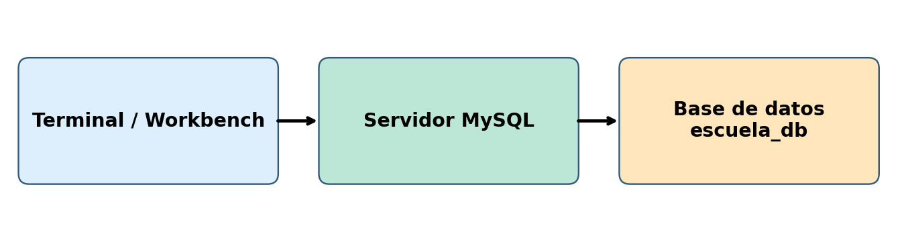
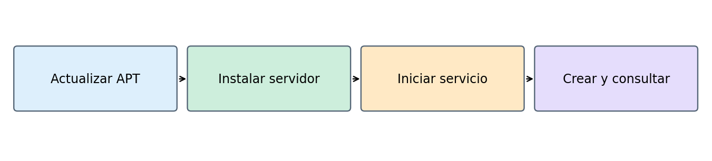

# MySQL en Ubuntu

> Guía académica para estudiantes:


INSTRUCTIVO DE INSTALACIÓN Y CREACIÓN DE LA PRIMERA BASE DE DATOS EN MySQL


Ubuntu 22.04 / 24.04 LTS · Nivel principiante


Guía paso a paso: instalación mediante terminal, administración gráfica con MySQL Workbench y alternativa con Docker.





Elaborado por: Victoria Arrieta


Fecha:12/11/2026


1. Introducción


2. Objetivo, propósito y alcance


3. Requisitos previos


4. Conceptos fundamentales


5. Instalación por terminal


6. Interfaz gráfica: MySQL Workbench


7. Alternativa mediante Docker


8. Primera base de datos y consultas


9. Errores frecuentes y soluciones


10. Seguridad, comprobación y conclusiones


11. Referencias


## Introducción


```bash
MySQL es un sistema de gestión de bases de datos relacionales (RDBMS). Organiza la información en tablas con filas y columnas y utiliza SQL (Structured Query Language) para crear, consultar y modificar datos. A diferencia de MongoDB, MySQL es una base de datos SQL relacional. Esta guía permite instalar un servidor local y realizar una primera práctica sin experiencia avanzada.
```


## Objetivo, propósito y alcance


Objetivo: instalar y verificar MySQL en Ubuntu, crear una base de datos y una tabla, insertar registros y realizar consultas SQL básicas.


Propósito: ofrecer un procedimiento reproducible y didáctico para estudiantes de fundamentos de bases de datos.


Alcance: equipos Ubuntu 22.04 o 24.04 LTS con acceso administrativo; servidor local para aprendizaje. No incluye despliegues productivos, alta disponibilidad ni exposición a Internet.


## Requisitos previos


| Elemento | Recomendación |
| --- | --- |
| Sistema operativo | Ubuntu 22.04 o 24.04 LTS, 64 bits |
| Hardware | 2 GB RAM mínimo para laboratorio sencillo; 4 GB recomendado; 2 GB libres o más |
| Permisos | Usuario con sudo |
| Conexión | Internet para descargar paquetes |
| Conocimientos | Abrir terminal, ejecutar comandos, nociones básicas de tablas |


Advertencia: las versiones disponibles dependen de los repositorios de Ubuntu. El paquete mysql-server de APT puede no coincidir con la versión más reciente publicada por Oracle.


## Conceptos fundamentales


Servidor MySQL: servicio que almacena y gestiona los datos. Cliente mysql: herramienta de línea de comandos para enviar instrucciones SQL. MySQL Workbench: aplicación gráfica opcional para administrar el servidor. Base de datos: conjunto organizado de tablas. Tabla: estructura de columnas y filas.





Figura 2. Secuencia general del procedimiento (ilustración didáctica).


## Instalación por terminal (método recomendado)


### Paso 1. Abrir la terminal


Presiona Ctrl + Alt + T. Comprueba la versión del sistema.


```bash
lsb_release -a
```


Resultado esperado: Se muestra la versión de Ubuntu.


### Paso 2. Actualizar el índice de paquetes


Actualiza la lista de software disponible antes de instalar.


```bash
sudo apt update
```


Resultado esperado: El comando finaliza sin errores de repositorios.


### Paso 3. Instalar el servidor MySQL


Instala el paquete distribuido por los repositorios configurados de Ubuntu.


```bash
sudo apt install mysql-server -y
```


Resultado esperado: APT instala el servidor y sus dependencias.


### Paso 4. Verificar el servicio


Consulta el estado del servicio. Si no está activo, inícialo.


```bash
sudo systemctl status mysql
sudo systemctl start mysql
sudo systemctl enable mysql
```


Resultado esperado: El estado muestra active (running). Para salir de status, presiona q.


### Paso 5. Comprobar la versión


Verifica que el cliente de MySQL esté instalado.


```bash
mysql --version
```


Resultado esperado: Aparece una versión de MySQL.


### Paso 6. Ingresar como administrador local


En instalaciones Ubuntu habituales, la cuenta root de MySQL utiliza autenticación mediante socket de Unix. Accede desde el sistema con sudo.


```bash
sudo mysql
```


Resultado esperado: Aparece el indicador mysql>. Si falla, revisa la sección de errores.


ADVERTENCIA: No cambies a contraseñas débiles ni habilites acceso remoto de root para resolver problemas. En un laboratorio local es preferible conservar el método de autenticación predeterminado.


## Interfaz gráfica: MySQL Workbench


Workbench NO instala por sí mismo el servidor MySQL: es un cliente visual para conectarse a un servidor ya instalado. En Ubuntu puede estar disponible como paquete en los repositorios habilitados o mediante descargas oficiales compatibles con la versión del sistema.


### Paso 7. Instalar Workbench (si el paquete está disponible)


Comprueba primero su disponibilidad. Si Ubuntu indica que no existe candidato, consulta el sitio oficial de MySQL Workbench para un paquete compatible.


apt policy mysql-workbench
sudo apt install mysql-workbench


Resultado esperado: Si se instala, podrás iniciar la aplicación desde el menú de aplicaciones.


### Paso 8. Crear conexión local en Workbench


Abre Workbench; selecciona una conexión nueva; hostname 127.0.0.1, puerto 3306 y un usuario MySQL válido. Para la cuenta root con autenticación socket, puede ser necesario crear un usuario de laboratorio con contraseña en lugar de usar root desde Workbench.


Resultado esperado: La conexión de prueba se completa correctamente.


Crea el usuario de laboratorio desde sudo mysql, si necesitas acceso por contraseña:


```sql
CREATE USER 'alumno'@'localhost' IDENTIFIED BY 'Cambia_Esta_Clave_2026!';
GRANT ALL PRIVILEGES ON escuela_db.* TO 'alumno'@'localhost';
```


Nota: el permiso sobre escuela_db puede configurarse antes de crearla; para conectar por TCP con 127.0.0.1, la coincidencia de host y método de autenticación puede requerir ajustes. Para principiantes, primero realiza la práctica desde la terminal.


## Alternativa mediante Docker (opcional)


Este método ejecuta MySQL dentro de un contenedor; no es necesario si ya utilizas la instalación por APT. Requiere Docker Engine funcionando. No ejecutes ambos servidores en el mismo puerto 3306.


```bash
docker volume create mysql_lab_data
docker run -d --name mysql-lab -e MYSQL_ROOT_PASSWORD='ClaveTemporalSegura_2026!' -e MYSQL_DATABASE=escuela_db -p 127.0.0.1:3307:3306 -v mysql_lab_data:/var/lib/mysql mysql:8.4
docker logs mysql-lab
docker exec -it mysql-lab mysql -uroot -p
```


Al solicitar la contraseña, escribe la definida en MYSQL_ROOT_PASSWORD. Espera a que el registro del contenedor indique que está listo. Se usa el puerto 3307 del equipo para evitar conflictos con una instalación local.


## Crear la primera base de datos y ejecutar SQL


Entra con sudo mysql (instalación APT) o desde el cliente del contenedor. Ejecuta las sentencias siguientes una a una. Cada instrucción SQL termina en punto y coma (;).


### Paso 9. Crear y seleccionar la base de datos


La instrucción CREATE DATABASE crea el espacio lógico; USE lo selecciona.


```sql
CREATE DATABASE IF NOT EXISTS escuela_db;
SHOW DATABASES;
USE escuela_db;
```


Resultado esperado: escuela_db aparece entre las bases de datos.


### Paso 10. Crear la tabla estudiantes


Define un identificador único y columnas de nombre, programa y edad.


```sql
CREATE TABLE IF NOT EXISTS estudiantes (
  id INT AUTO_INCREMENT PRIMARY KEY,
  nombre VARCHAR(80) NOT NULL,
  programa VARCHAR(100) NOT NULL,
  edad INT
);
SHOW TABLES;
```


Resultado esperado: Se muestra la tabla estudiantes.


### Paso 11. Insertar tres registros


```sql
INSERT INTO agrega datos de ejemplo.
```


```sql
INSERT INTO estudiantes (nombre, programa, edad) VALUES
('Ana Ruiz', 'Soporte de Sistemas', 20),
('Luis Perez', 'Desarrollo Web', 22),
('Sara Gomez', 'Bases de Datos', 21);
```


Resultado esperado: El servidor confirma tres filas insertadas.


### Paso 12. Consultar y filtrar registros


```sql
SELECT permite visualizar los datos. WHERE filtra los resultados.
```


```sql
SELECT * FROM estudiantes;
SELECT nombre, programa FROM estudiantes WHERE edad >= 21;
SELECT COUNT(*) AS total FROM estudiantes;
```


Resultado esperado: Se observan tres registros y total = 3 (si no se ejecutó antes la inserción).


### Paso 13. Actualizar y eliminar un dato de prueba


Practica UPDATE y DELETE usando WHERE para evitar afectar todas las filas.


```sql
UPDATE estudiantes SET edad = 23 WHERE nombre = 'Luis Perez';
DELETE FROM estudiantes WHERE nombre = 'Sara Gomez';
SELECT * FROM estudiantes;
```


Resultado esperado: Quedan dos registros. Puedes repetir la práctica recreando la tabla.


### Paso 14. Salir y comprobar persistencia


Cierra el cliente, vuelve a entrar y consulta la tabla.


EXIT;
sudo mysql -e "SELECT * FROM escuela_db.estudiantes;"


Resultado esperado: Los datos permanecen almacenados después de cerrar el cliente.


## Errores frecuentes y soluciones


| Problema | Posible causa / solución |
| --- | --- |
| Unable to locate package mysql-server | Ejecuta sudo apt update; verifica conexión y repositorios de Ubuntu. |
| Unit mysql.service not found | El paquete no se instaló; comprueba dpkg -l mysql-server. |
| Access denied for user root | En Ubuntu prueba sudo mysql; no supongas que root tiene contraseña. |
| Can't connect to local MySQL server | Verifica sudo systemctl status mysql; inicia servicio y revisa logs. |
| Port 3306 already in use | Otro servidor usa el puerto; para Docker usa 3307 local. |
| Workbench no disponible en APT | Consulta paquete oficial compatible; la terminal sigue siendo suficiente. |
| ERROR 1046 No database selected | Ejecuta USE escuela_db; antes de crear tablas. |
| ERROR 1062 Duplicate entry | Hay una clave primaria repetida; usa AUTO_INCREMENT y evita IDs duplicados. |
| ERROR 1064 SQL syntax | Revisa comas, paréntesis, comillas y punto y coma final. |


Diagnóstico útil:


```bash
sudo journalctl -u mysql --no-pager -n 40
sudo systemctl restart mysql
```


## Seguridad, lista de verificación y conclusiones


Seguridad: usa contraseñas robustas para usuarios con contraseña; limita permisos; evita exponer el puerto 3306 a redes externas; no uses root en aplicaciones; realiza respaldos antes de borrar datos. En instalaciones nuevas revisa las opciones de endurecimiento disponibles, como mysql_secure_installation, comprendiendo cada pregunta antes de confirmar.


Lista de verificación:


[ ] Ubuntu y acceso sudo verificados


[ ] MySQL instalado y servicio activo


[ ] Acceso al cliente mysql confirmado


[ ] Base escuela_db creada


[ ] Tabla estudiantes creada


[ ] Registros insertados y consultados


[ ] Errores identificados y documentados


Conclusión: el estudiante instaló un motor relacional, distinguió servidor y cliente, creó su primera base de datos y ejecutó operaciones SQL esenciales. La terminal permite completar toda la práctica; Workbench y Docker son opciones complementarias.


## Referencias y recursos oficiales


```bash
MySQL Reference Manual: https://dev.mysql.com/doc/refman/8.4/en/
```


```bash
MySQL Workbench: https://dev.mysql.com/doc/workbench/en/
```


Ubuntu Server – MySQL: https://documentation.ubuntu.com/server/how-to/databases/install-mysql/


```bash
Docker Official Image mysql: https://hub.docker.com/_/mysql
```


Nota editorial: diagramas originales ilustrativos; no son capturas de pantalla de una ejecución real. Los nombres y registros de ejemplo son ficticios.
